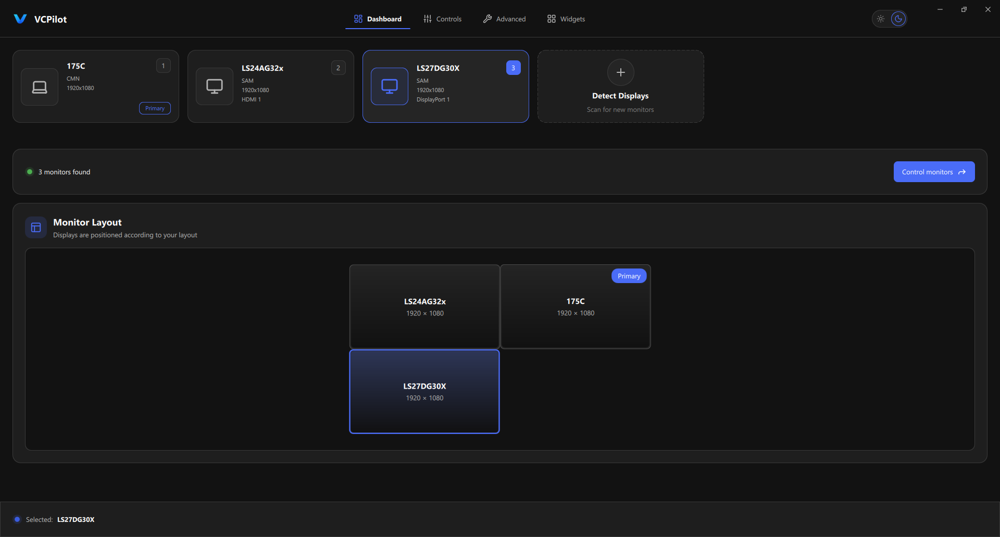
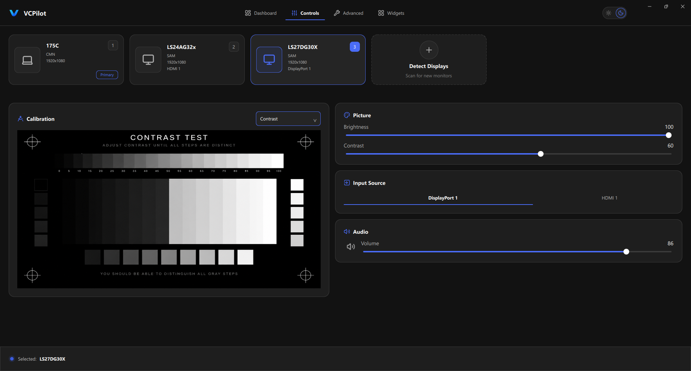
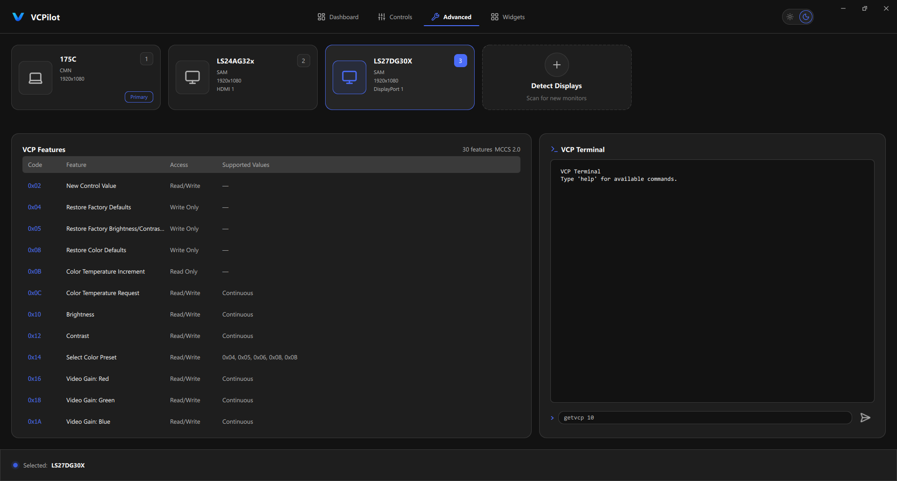
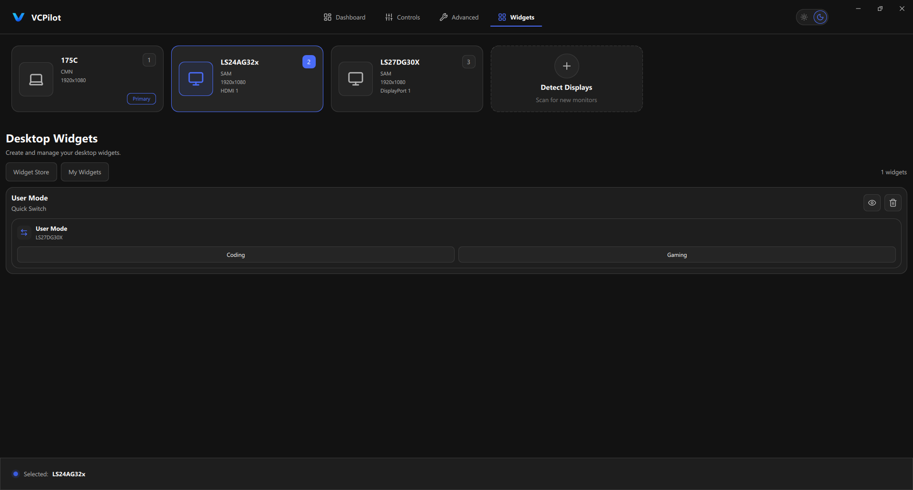
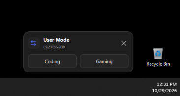

# VCPilot

**VCPilot** is a Windows desktop application for controlling external monitors through **DDC/CI (MCCS)**. Built with **C++23 and Qt 6 / QML**, it provides a graphical interface, a command-line tool, and lightweight desktop widgets for quick input switching.

## Features

- **Monitor discovery** — Detect connected displays and inspect monitor information and capabilities.
- **Everyday controls** — Adjust brightness, contrast, input source, and supported audio settings.
- **Desktop widgets** — Create Quick Switch widgets with custom input labels to switch monitor inputs directly from the desktop.
- **Persistent widgets** — Restore saved widget configurations, positions, and visibility between sessions.
- **System tray** — Keep VCPilot running when the main window is closed, and reopen or exit it from the tray.
- **Advanced VCP access** — Explore supported MCCS features and send raw VCP commands through an in-app terminal.
- **CLI** — Access monitor information and controls from the command line.
- **Responsive interface** — Run monitor discovery and state updates asynchronously, with dark and light themes.

*Available controls depend on the connected monitor's DDC/CI support.*

## Screenshots

### Dashboard

Discover monitors and view their arrangement.



### Monitor Controls

Manage picture settings, input sources, and audio controls.



### Advanced Controls

Inspect supported VCP features and use the built-in terminal.



### Desktop Widgets

Create and manage quick-access input-switching widgets.



**Quick Switch widget on the Windows desktop:**



## Tech Stack

**C++23** · **Qt 6 / QML** · **Windows DDC/CI APIs** · **CMake** · **Ninja** · **Conan 2** · **MSVC** · **CLI11** · **spdlog** · **fmt** · **Catch2 / CTest**

## Build

**Requirements:** Windows, MSVC / Visual Studio C++ Build Tools, Qt 6, CMake, Ninja, Conan 2, and Python.

```bash
conan install . --build=missing -s build_type=Release
cmake --preset conan-release
cmake --build --preset conan-release
```

Run the GUI with `vcpilot_gui` or explore the CLI with `vcpilot_cli --help`.

To run tests:

```bash
ctest --preset conan-release --output-on-failure
```

## License

MIT License.
